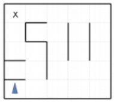

<div align="center">

# 🚗 Automóvel no Labirinto 🧩

**Agente inteligente que conduz um automóvel num labirinto usando procura em espaço de estados**




</div>

---

## 📋 Informações

| | |
|---|---|
| 👤 **Autor** | Pedro Rosa (Grupo 58) |
| 🏫 **Instituição** | Faculdade de Ciências da Universidade de Lisboa |
| 📚 **Unidade curricular** | Sistemas Inteligentes |
| 📅 **Ano letivo** | 2023/2024 |
| 🗓️ **Data de entrega** | 15 de março de 2024 |

---

## 🎯 Sobre o Projeto

O objetivo é implementar um agente capaz de conduzir um automóvel num labirinto discreto, desde a posição inicial até à saída, **parando exatamente na saída** (velocidade 0) e usando o menor número possível de ações.

Ao contrário de um simples problema de caminhos, o carro tem **orientação** e **inércia**: não pode parar instantaneamente nem atravessar paredes, por isso tem de gerir a velocidade com cuidado.

### 🧠 Estado

Cada estado é uma lista `[linha, coluna, velocidade, orientação]`, por exemplo `[5, 1, 0, "N"]`.

- **Orientação:** `N` (Norte), `E` (Este), `S` (Sul), `O` (Oeste)
- **Velocidade:** entre `0` e `vmax` (por omissão `vmax = 3`)

### 🕹️ Ações

| Ação | Significado | Quando é possível |
|:---:|---|---|
| `E` | Rodar para a **esquerda** | Só com o carro parado |
| `D` | Rodar para a **direita** | Só com o carro parado |
| `A` | **Acelerar** (+1 de velocidade, avança) | Se não bater numa parede |
| `T` | **Travar** (−1 de velocidade, avança) | Se o carro estiver em movimento |

### 🗺️ Representação do labirinto

O labirinto é uma *string*, com as células separadas por espaços e as linhas terminadas em `\n`:

```
= = = = = = =
= x . . . . =
= . . . = . =
= . . . = . =
= = = . = . =
= ^ . . . . =
= = = = = = =
```

| Símbolo | Significado |
|:---:|---|
| `=` | Parede |
| `.` | Estrada livre |
| `x` | Saída (objetivo) |
| `^` `>` `v` `<` | Carro na posição inicial, virado para N / E / S / O |

---

## 📁 Estrutura

```
Automovel-Labirinto/
├── Labirinto_SInt_23_24-grupo58.py   # Classe Labirinto (solução)
├── searchPlus.py                     # Algoritmos de procura (BFS, DFS, A*, ...)
├── utils.py                          # Funções auxiliares usadas pelo searchPlus
├── Enunciado.ipynb                   # Enunciado do trabalho e testes
└── labirinto.png                     # Imagem ilustrativa
```

---

## ▶️ Como Executar

### 1. Pré-requisitos

- **Python 3.8+**
- *(Opcional)* **Jupyter** para abrir o enunciado: `pip install notebook`

Não são precisas bibliotecas externas: tudo o que o projeto usa está em `searchPlus.py` e `utils.py`.

### 2. Clonar o repositório

```bash
git clone https://github.com/pedrorosa3/Automovel-Labirinto.git
cd Automovel-Labirinto
```

### 3. Correr no modo interativo

O ficheiro não tem um `main`, por isso o mais simples é carregá-lo no modo interativo do Python:

```bash
python -i Labirinto_SInt_23_24-grupo58.py
```

E depois, na consola:

```python
>>> p = Labirinto()                       # labirinto por omissão, vmax = 3
>>> print(p.display(p.initial))           # mostra o labirinto
>>> p.actions(p.initial)                  # ações possíveis no estado inicial
>>> sol = breadth_first_graph_search(p)   # resolve o problema
>>> sol.solution()                        # sequência de ações encontrada
>>> p.executa(p.initial, sol.solution(), verbose=True)  # simula passo a passo
```

### 4. Usar um labirinto personalizado

```python
>>> lab = ("= = = = = =\n"
...        "= > . . x =\n"
...        "= = = = = =\n")
>>> p = Labirinto(lab, vmax=2)
>>> breadth_first_graph_search(p).solution()
```

### 5. Pelo Jupyter Notebook

```bash
jupyter notebook Enunciado.ipynb
```

O notebook tem o enunciado completo e células de teste para a classe `Labirinto`.

---

## 🛠️ Implementação

A classe `Labirinto` estende `Problem` (de `searchPlus.py`) e implementa:

- `__init__(LabInicial, vmax)`: lê a grelha e determina o estado inicial e a saída
- `actions(state)`: devolve as ações válidas sem colisões
- `result(state, action)`: devolve o novo estado depois de aplicar a ação
- `goal_test(state)`: verifica se o carro está **parado na saída**
- `display(state)`: devolve o labirinto em texto, com o carro desenhado
- `executa(state, actions, verbose)`: executa uma sequência de ações e devolve `(estado, custo, objetivo_atingido)`

Como cada ação custa 1, a **procura em largura** (`breadth_first_graph_search`) e a **procura de custo uniforme** (`uniform_cost_search`) encontram um plano ótimo.

---

<div align="center">

*Projeto desenvolvido para fins educativos — FCUL, Sistemas Inteligentes 2023/2024* 🎓

</div>
